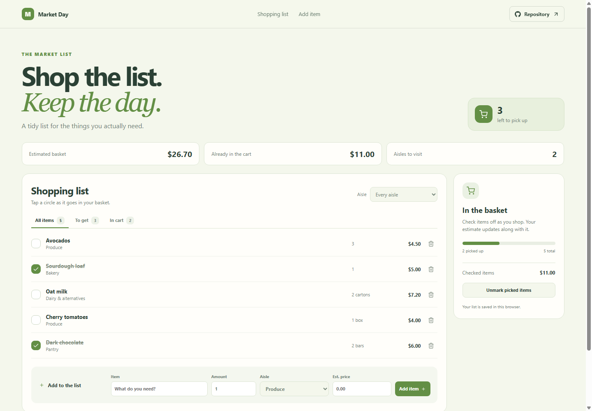

# Market Day: Grocery List Planner

Market Day helps you prepare a grocery run, sort items by aisle, and track what is already in the basket. The estimate gives a quick planning total rather than a receipt.

**GitHub Pages URL:** https://a2rp.github.io/grocery-list-planner/ (available after deployment)

## Included

- Add items with amount, aisle, and an optional estimated price.
- Filter the list by all items, items to get, or items in the cart.
- Filter by aisle and check off an item as it goes into the basket.
- See the remaining item count, aisle count, estimated total, and checked-item total.
- Unmark picked items to start a fresh shop and remove an item with confirmation.

## How to use it

Add the groceries you need and choose an aisle and amount. At the store, tap the circle beside each item. Use the aisle and status controls to focus the list.

## Data and limits

The shopping list is saved in this browser using localStorage. Prices are estimates entered by you, and the app does not connect to a store or update prices.

This is a browser-only utility. Clearing the browser’s site data removes its saved information.

## Run locally

~~~sh
npm install
npm run dev
~~~

## Checks and deployment

~~~sh
npm run lint
npm run build
npm run deploy
~~~

The deploy command builds the project and publishes the dist directory to the gh-pages branch. It requires the project’s public GitHub repository to be configured as origin.

## Future improvements

Ideas only. These are not implemented yet:

- Add recurring weekly lists and multiple shops.
- Import pantry quantities into the shopping list.
- Add store-specific prices and receipt totals.

## Links

- Portfolio: [https://www.ashishranjan.net](https://www.ashishranjan.net)
- GitHub: [https://github.com/a2rp](https://github.com/a2rp)
- CodePen: [https://codepen.io/ash1198](https://codepen.io/ash1198)
- LinkedIn: [https://www.linkedin.com/in/aashishranjan](https://www.linkedin.com/in/aashishranjan)
- Facebook: [https://www.facebook.com/theash.ashish/](https://www.facebook.com/theash.ashish/)
- YouTube: [https://www.youtube.com/@ashishranjan-ashz?sub_confirmation=1](https://www.youtube.com/@ashishranjan-ashz?sub_confirmation=1)
- Email: [mailto:ash.ranjan09@gmail.com](mailto:ash.ranjan09@gmail.com)

## Support

- Support: [https://a2rp-donation-page.netlify.app/](https://a2rp-donation-page.netlify.app/)
- Buy Me a Coffee: [https://buymeacoffee.com/ashishranjan](https://buymeacoffee.com/ashishranjan)
- Patreon: [https://www.patreon.com/ashishranjan](https://www.patreon.com/ashishranjan)